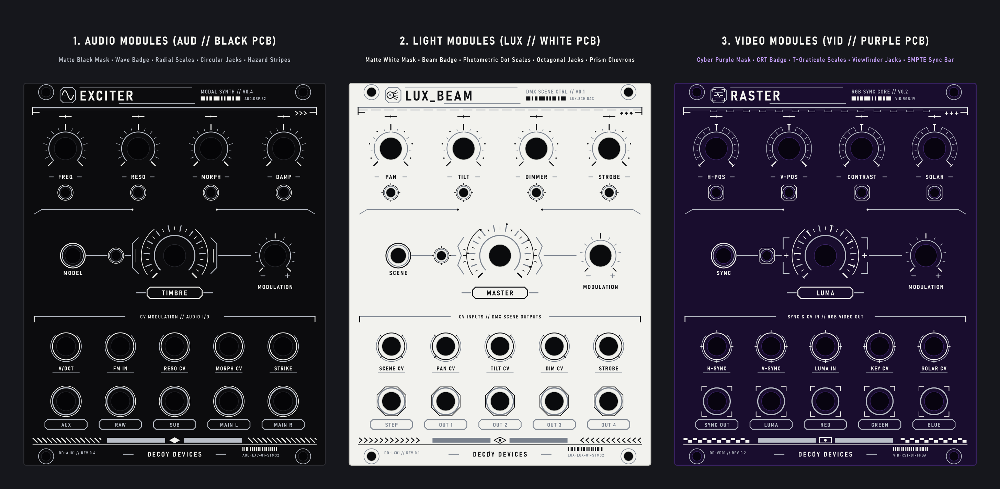

# DECØY DEVICES – Universal Eurorack PCB Panel Generator (`Panel_generator`)

**`Panel_generator`** is a standalone Python/Inkscape PCB panel artwork SDK for generating manufacturing-ready **KiCad SVG layers** (`F_SilkS.svg`, `F_Silver_Cu_Mask.svg`, `Edge_Cuts.svg`) and 300 DPI composite previews (`preview.svg`, `preview.png`) following the **DECØY DEVICES** industrial cyberpunk / HUD graphic standard.

It supports **3 distinct Eurorack module categories** (**`LIGHT`**, **`AUDIO`**, **`VIDEO`**) with dedicated HUD iconography, divider motifs, footer bars, series codes, and **configurable PCB solder mask & surface finish colors**.



---

## Visual Distinction: `AUDIO` (Black) vs. `LIGHT` (White) vs. `VIDEO` (Purple)

All three module categories share the **exact same unified architectural grid, typography, and hierarchy**, while differentiating **6 coordinated visual elements** across the entire panel:

| Visual Element | 1. Audio Modules (`AUDIO`) | 2. Lighting Modules (`LIGHT`) | 3. Video Modules (`VIDEO`) |
| :--- | :--- | :--- | :--- |
| **Default PCB Solder Mask** | **`black` (`#0c0c0e` Matte Black)** + White Silk + Silver Copper | **`white` (`#f2f2ee` Matte White)** + Black Silk + Silver Copper | **`purple` (`#190d2e` Cyber Purple)** + White Silk + Silver Copper |
| **Series Prefix** | **`AUD`** (`AUD.DSP.32`, `AUD-EXC-01`) | **`LUX`** (`LUX.8CH.DAC`, `LUX-KFR-01`) | **`VID`** (`VID.RGB.1V`, `VID-RST-01`) |
| **Header Badge & Divider** | **Oscilloscope Sine Wave** + continuous double line & `>>>` chevrons | **Stage Lens Aperture & 5 Beam Rays** + segmented beam line & `◆◆◆` nodes | **CRT Viewfinder Brackets & Sync Pulse** + H-Sync step line & `+++` crosshairs |
| **Pot Scales & Center Emblem** | **Radial tick lines** + continuous `270°` arc + chamfered wing brackets | **4-Segment photometric halo & beam dots** + faceted Fresnel prism wings | **Dual graticule arcs & orthogonal T-ticks** + square CRT viewfinder brackets |
| **3.5mm Jack & LED Bezels** | **Concentric circular rings** (both jacks and LEDs) | **Octagonal faceted aperture bezels** on outputs, diagonal prism ticks on inputs, 4-ray LEDs | **Corner viewfinder brackets (`[ ]`)** on outputs, cardinal sync ticks on inputs, chamfered-square LEDs |
| **Footer Bar Pattern** | **45° industrial hazard stripes (`\\\\\\`)** + center **diamond (`◆`)** | **Opposing optical beam chevrons (`>>>>` / `<<<<`)** + center **sunburst (`◈`)** | **Dual-row SMPTE checkerboard sync blocks** + center **CRT aspect frame (`[•]`)** |

---

## Configurable PCB Solder Masks & Surface Finishes

Any module can be rendered with any combination of `--category`, `--mask`, and `--finish`:

* **Solder Masks (`--mask`):**
  * `black` – Matte Black (`#0c0c0e`)
  * `blue` – Deep Synth Navy Blue (`#0a1526`)
  * `red` – Deep Video Crimson (`#1e090d`)
  * `green` – Dark Industrial Green (`#081c12`)
  * `purple` – Cyber Violet (`#140b24`)
* **Copper Finishes (`--finish`):**
  * `silver` – HASL / Immersion Tin (`#b9bec7`)
  * `gold` – ENIG Immersion Gold (`#d6b24c`)

---

## Directory Structure

| File | Description |
| :--- | :--- |
| [`panel_sdk.py`](panel_sdk.py) | Core `PanelCanvas` SDK class, geometric SVG primitives, `LIGHT`/`AUDIO`/`VIDEO` header & footer builders, pot scales, LEDs, jacks, and KiCad/Inkscape exporter |
| [`gen_keyframes.py`](gen_keyframes.py) | Generator for the 20 HP **`Key_frames`** 8-channel DMX/CV scene controller panel |
| [`gen_showcase.py`](gen_showcase.py) | Generator for [`category_comparison.png`](category_comparison.png) comparing `LIGHT`, `AUDIO`, and `VIDEO` modules side-by-side |
| [`build.ps1`](build.ps1) | PowerShell build script running Python + Inkscape CLI (`--export-text-to-path` and 300 DPI PNG export) |
| [`Manuál/GRAPHIC_MANUAL.md`](Manuál/GRAPHIC_MANUAL.md) | Full technical & graphic design manual (in Czech) |

---

## Quick Start Usage

### 1. Build All Previews & `Key_frames` Panel (PowerShell)
```powershell
powershell -ExecutionPolicy Bypass -File .\build.ps1
```

### 2. Generate `Key_frames` with Custom Category / Mask / Finish
```powershell
& "C:\Program Files\KiCad\10.0\bin\python.exe" .\gen_keyframes.py --category LIGHT --mask black --finish silver
```

### 3. Create a New Panel in Python using `panel_sdk.py`
```python
from panel_sdk import PanelCanvas

# Create a 20HP panel for LIGHT, AUDIO, or VIDEO
panel = PanelCanvas(hp=20, category="AUDIO", mask="blue", finish="silver")
panel.add_mounting_holes()
panel.add_header(title="EXCITER", subtitle="MODAL SYNTHESIZER // V0.4", sys_code="DSP.32")

# Add pots, LEDs, and jacks
panel.pot_scale(50.7, 45.0, r_hole=3.75, style="big")
panel.led_indicator(50.7, 62.0, r_hole=1.6)
panel.jack_graphic(50.7, 100.0, r_hole=3.2, is_output=True)

panel.add_footer(serial_left="DD-AU01 // REV 0.4", serial_right="EXC-01-STM32")
panel.export_all("./output_exciter")
```

