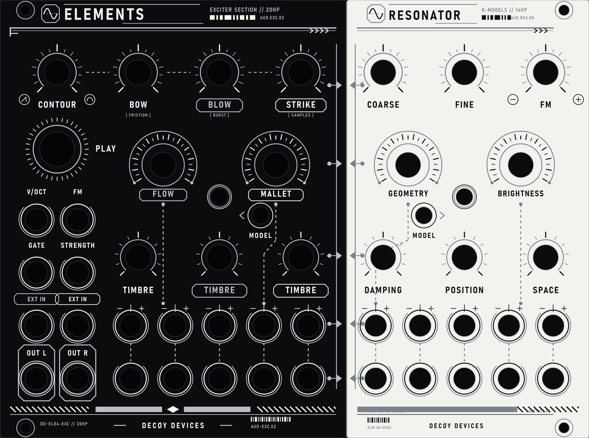

# Mutable Instruments Elements – Revision v0.4 (STM32H743)

[](https://www.st.com/)
[](https://www.arm.com/)
[](https://www.ti.com/product/PCM3060)
[](https://kicad.org/)
[](#)
[](#license)

Hardware and firmware revision (**v0.4**) of the **Mutable Instruments Elements** Eurorack modal synthesizer module. This version updates the hardware platform to an **ARM Cortex-M7 (STM32H743)** microcontroller, adds **two dedicated hardware model-selection buttons**, introduces **2 selectable exciter modes** (Classic & Industrial), expands the resonator engine to **8 algorithms** (original Elements, ported Rings models, and Kammerl Spectral Clouds), replaces the audio codec with a hardware-configured **TI PCM3060**, and upgrades signal acquisition to **16-bit SAR ADCs**.

---

## Front Panel Design (Decøy Devices Edition)

### Dual-Tone Split PCB Panel (20 HP Exciter + 14 HP Resonator)



Two-piece PCB panel designed for distinct solder mask colors:
- **EXCITER (20 HP / 101.4 mm):** Matte Black solder mask, white silkscreen, silver (HASL / immersion tin) exposed copper traces.
- **RESONATOR (14 HP / 70.9 mm):** Pure White solder mask, black silkscreen, silver (HASL / immersion tin) exposed copper traces.
- **Eurorack Grid & Clamping:** As the underlying motherboard is a single continuous PCB, the two front panels are firmly secured together and clamped against the motherboard by all 17 potentiometers and 28 audio/CV jacks. Therefore, **all inner rack mounting holes at the split seam have been eliminated**, leaving only 4 standard outer Eurorack mounting holes (2 on the far-left at x = 7.49 mm, 2 on the far-right at x = 63.57 mm local / 164.97 mm global).
- **Dedicated Hardware Model Selectors:**
  - **Exciter Model Switch (PA9):** Toggles between **1: CLASSIC** (original Bow/Blow/Strike generators) and **2: INDUSTRIAL** (metal friction `[ FRICTION ]`, digital burst `[ BURST ]`, and industrial sample set `[ SAMPLES ]`).
  - **Resonator Model Switch (PE9):** Steps through **8 resonator models** (3 original, 4 ported from Rings, and 1 Kammerl Spectral Clouds implementation) with visual pulse LED feedback.

Complete production vector layers (`F.SilkS`, `F.Cu` / `F.Mask`, `Edge.Cuts`) and fabrication specifications are documented in the [Graphic Manual](hardware_design/panel/pcb_art/GRAPHIC_MANUAL.md).

---

## Technical Comparison: v0.3 vs. v0.4

| Specification / Feature | Elements v0.3 | Elements v0.4 | Technical Impact |
| :--- | :--- | :--- | :--- |
| **Microcontroller (MCU)** | STM32F405RGT6 | **STM32H743VIT6** | Upgraded CPU core and instruction throughput |
| **Architecture** | ARM Cortex-M4F | **ARM Cortex-M7** (with L1 cache) | Superscalar pipeline, 16 kB I-cache + 16 kB D-cache |
| **Clock Frequency** | 168 MHz | **480 MHz** (VOS0 power profile) | ~2.85x higher raw clock frequency |
| **Internal RAM** | 192 kB (128 kB SRAM + 64 kB CCM) | **1024 kB (1 MB)** AXI/SRAM | 5.3x increase in memory; larger delay and reverb buffers |
| **Flash Memory** | 1024 kB (1 MB) | **2048 kB (2 MB)** | Double the storage space for firmware, tables, and samples |
| **Floating Point Unit** | Single-precision (FPv4-SP) | **Double & Single-precision** (FPv5-D16) | Native hardware double-precision calculations |
| **Hardware Buttons** | 1x Button (Play / SW_GATE) | **3x Buttons (Play + 2x Model Selectors)** | Direct stepped selection for Exciter and Resonator models |
| **Exciter Engine** | 1 model (Classic Bow, Blow, Strike) | **2 models** (Classic & Industrial Friction/Burst/Samples) | Dual excitation engines selectable via Exciter Model button |
| **Resonator Models** | 3 models (Modal, String, Chords) | **8 models** (Original + Rings + Kammerl Spectral Clouds) | Expanded physical modeling, FM, string-synth, and spectral clouds |
| **Audio Codec** | Wolfson WM8731 | **Texas Instruments PCM3060** | 24-bit 96/192 kHz asynchronous stereo codec |
| **Codec Control Interface** | Software register init via I2C | **Hardware mode (hardwired pins)** | No I2C/SPI bus initialization; immune to bus hang-up |
| **Audio Output Op-Amp** | TI/National LME49720 (dual) | **TI OPA1664D** (quad SoundPlus) | THD+N 0.00006 %, lower noise floor |
| **CV ADC Resolution** | 12-bit (4,096 counts) | **16-bit SAR ADC** (65,536 counts) | 16x higher resolution on 1V/Oct and CV inputs |
| **Potentiometer ADC** | 12-bit ADC | **16-bit ADC** via 4x 74HC4051 | Finer parameter tracking, no parameter quantization steps |
| **Oscillator / Crystal** | 8 MHz crystal | **25 MHz SMD** (NX2016SA-25MHZ) | Lower profile package, stable high-frequency clocking |
| **LED Modulation** | Low-frequency timer PWM | **TIM1 PWM at ~133 kHz** (from 240 MHz clock) | Eliminates visible flicker in optical/video captures |
| **EDA Project Format** | CadSoft Eagle (`.sch`, `.brd`) | **KiCad (v8 / v10)** | Multi-sheet hierarchical schematic structure |

---

## Hardware Architecture & Interconnects

```
                       +-----------------------------------+
                       |         STM32H743VIT6             |
                       |      ARM Cortex-M7 @ 480 MHz      |
                       |       2 MB Flash / 1 MB RAM       |
                       +-----------------------------------+
                             |          |          |
           +-----------------+          |          +-----------------+
           |                            |                            |
    ANALOG CV INPUTS             TACTILE SWITCHES (3x)       POTENTIOMETERS (32x)
    16-bit ADC1 (DMA Stream 0)   PC13: Play / Manual Gate    16-bit ADC2 (PC0)
    13 channels (V/Oct, FM...)   PA9:  Model Switch 1        4x 74HC4051 Multiplexers
    Buffers: MCP6004             PE9:  Model Switch 2        Address: PC13, PC15
    Ref: LM4040 10.0V                                        Enables: PB5, PB6, PB7, PB8
           |                            |                            |
           +-----------------+          |          +-----------------+
                             |          |          |
                       +-----------------------------------+
                       |       TI PCM3060 AUDIO CODEC      |
                       |        24-bit 48 kHz / I2S2       |
                       |      Hardware-configured mode     |
                       +-----------------------------------+
                                        |
                       +-----------------------------------+
                       |          TI OPA1664D              |
                       |       Audio Output Filters        |
                       |        OUT (L) / AUX (R)          |
                       +-----------------------------------+
```

---

## Software & Firmware Architecture Changes

### 1. STM32H7 HAL & System Core Initialization (`drivers/system.cc`)
- **HAL Migration:** Full migration from STM32 Standard Peripheral Library (SPL) to **STM32H7 HAL** (`stm32h7xx_hal.h`).
- **Power Configuration:** Operates in internal LDO regulator mode with **Voltage Scale 0 (VOS0)** enabled, required for stable 480 MHz CPU operation.
- **Clock Tree:**
  - HSE: External 25 MHz oscillator (or 8 MHz legacy) multiplied via PLL1.
  - SYSCLK = 480 MHz (D1 domain CPU core).
  - HCLK = 240 MHz (AXI and AHB1/2/3 buses).
  - APB1..4 = 120 MHz.
  - Timer clocks = 240 MHz on APB timer branches.
- **Cache Control:** Configures L1 Instruction Cache (16 kB) and Data Cache (16 kB) to eliminate flash wait-state stalls during real-time DSP calculation.

### 2. Two Dedicated Hardware Buttons & UI State Machine (`drivers/switch.cc`, `ui.cc`)
- **Physical Buttons Added:**
  - `SWITCH_MODEL_1` on pin `PA9` (active-high with internal pull-down): Exciter Model selector.
  - `SWITCH_MODEL_2` on pin `PE9` (active-high with internal pull-down): Resonator Model selector.
- **Driver Layer:** `drivers/switch.cc` scans all 3 inputs (`SWITCH_PLAY`, `SWITCH_MODEL_1`, `SWITCH_MODEL_2`) with software debouncing.
- **Direct Model Selection:**
  - `SWITCH_MODEL_1` toggles between the **2 Exciter models** (1: Classic, 2: Industrial Metal/Burst/Samples).
  - `SWITCH_MODEL_2` cycles through the **8 Resonator models** (`(current_model + 1) % 8`).
- **Visual Feedback (`UI_MODE_DISPLAY_MODEL`):** The module enters a display mode where the front-panel LEDs pulse to indicate the currently active model index. Normal display resumes automatically after 4 seconds of idle time.
- **Persistent Storage:** Every model change is immediately written to non-volatile calibration memory (`cv_scaler_->SaveCalibration()`) and automatically restored upon reboot.

### 3. Audio Codec Driver (`drivers/codec.cc`)
- Rewritten for the **Texas Instruments PCM3060** over SPI2/I2S2 in full-duplex circular DMA mode.
- Replaced the Wolfson WM8731 software register initialization with hardware-mode pin configuration (no I2C/SPI control transactions required).
- Frame size: `kAudioChunkSize = 16` stereo frames per block at 48 kHz (low-latency audio throughput of ~0.33 ms).

### 4. 16-bit Dual ADC Subsystem (`drivers/cv_adc.cc`, `drivers/pots_adc.cc`)
- **ADC1 (CV Inputs):** Configured for 16-bit SAR resolution. Samples 13 CV channels continuously into a circular DMA buffer (DMA2 Stream 0 via DMAMUX1).
- **ADC2 (Potentiometers):** Sequentially samples 32 potentiometers routed through four 74HC4051 8-channel analog multiplexers via digital address control (`PC13`, `PC15`, `PB5..PB8`).

### 5. High-Frequency LED PWM (`drivers/leds.cc`)
- Replaces low-frequency general-purpose timer PWM with **TIM1** running from the 240 MHz APB2 timer clock.
- Prescaler and period configured for ~133 kHz carrier frequency, preventing optical rolling bars or flicker in camera and video recordings.

---

## Expanded Exciter & Resonator DSP Models (`dsp/voice.cc`, `dsp/voice.h`)

Revision v0.4 incorporates algorithms ported from **Mutable Instruments Rings** and the **Kammerl Spectral Clouds** DSP engine, expanding the synthesis range:

### Exciter Models (Switch 1)

| Index | Mode Name | Bow Engine | Blow Engine | Strike Engine |
| :---: | :--- | :--- | :--- | :--- |
| **1** | **CLASSIC** | Physical friction bow model | Turbulent airflow noise | Granular/mallet impulse generator |
| **2** | **INDUSTRIAL** | Metal-on-metal friction (`[ FRICTION ]`) | Digital burst & granular noise (`[ BURST ]`) | Industrial raw sample playback (`[ SAMPLES ]`) |

*(Note: Custom sample bank and industrial firmware extension will be merged in subsequent steps).*

### Resonator Models (Switch 2)

| Index | Model Enum | Origin | Algorithmic Description |
| :---: | :--- | :--- | :--- |
| **0** | `RESONATOR_MODEL_MODAL` | Elements v0.3 | Bank of 64 resonant band-pass filters simulating plates, bars, and membranes. |
| **1** | `RESONATOR_MODEL_STRING` | Elements v0.3 | Non-linear string model with dispersion and sympathetic coupling. |
| **2** | `RESONATOR_MODEL_STRINGS` | Elements v0.3 | 5-voice sympathetic string chord cluster. |
| **3** | `RESONATOR_MODEL_SYMPATHETIC_STRING_QUANTIZED` | Ported from Rings | 5-string sympathetic resonator quantized to semitone chord tables. |
| **4** | `RESONATOR_MODEL_STRING_AND_REVERB` | Ported from Rings | Single inharmonic string model running directly through an integrated reverberator. |
| **5** | `RESONATOR_MODEL_FM_VOICE` | Ported from Rings | 2-operator FM voice with variable feedback, ratio, and internal decay envelope. |
| **6** | `RESONATOR_MODEL_STRING_SYNTH` | Ported from Rings | Solina/string-machine ensemble oscillator with divide-down filter architecture. |
| **7** | `RESONATOR_MODEL_SPECTRAL_CLOUDS` | Kammerl DSP | Real-time spectral granulator and phase-randomized modal reverberator. |

### Auxiliary DSP Features
- **Exciters (`dsp/exciter.cc`):** Both Classic and Industrial exciters feed into all 8 resonator engines.
- **Easter Egg Mode (`dsp/ominous_voice.cc`):** 2x2-operator FM synthesizer engine derived from Mutable Instruments Braids FM/FBFM modes.

---

## Directory Structure

```
elements/
├── bootloader/             # Audio bootloader for QPSK firmware updates
├── drivers/                # STM32H7 HAL hardware drivers
│   ├── codec.cc / .h       # Full-duplex I2S2 DMA driver for TI PCM3060
│   ├── cv_adc.cc / .h      # 16-bit DMA circular driver for ADC1 (CV inputs)
│   ├── pots_adc.cc / .h    # Multiplexed ADC2 driver for front panel pots
│   ├── leds.cc / .h        # TIM1 high-frequency PWM driver for indicator LEDs
│   ├── switch.cc / .h      # 3-button debounced GPIO driver (Play + 2x Model)
│   └── system.cc / .h      # Power (VOS0), RCC clocks (480 MHz), and bus setup
├── dsp/                    # Audio synthesis and DSP processing core
│   ├── fm_voice.cc / .h    # Rings 2-operator FM synthesis voice
│   ├── ominous_voice.cc    # Easter egg 2x2-op FM voice
│   ├── part.cc / .h        # Voice allocator and parameter distributor
│   ├── resonator.cc / .h   # 64-mode modal filter bank
│   ├── string_synth_part.cc# String synth / Solina ensemble model
│   └── voice.cc / .h       # Top-level voice coordinator supporting all 7 models
├── hardware_design/        # Hardware documentation and CAD assets
│   ├── panel/              # Mechanical panel drawings (Elements_V2.dxf, ElementsV04.svg)
│   │   └── pcb_art/        # Cyberpunk PCB panel vector artwork & Graphic Manual
│   └── pcb/elements_v02/   # KiCad v0.4 project files
├── cv_scaler.cc / .h       # Calibration, linearization, and CV parameter mapping
├── elements.cc             # Application main loop and audio callback buffer
├── makefile                # Make build system targeting STM32H7xx
├── stm32h743vi.pdf         # Reference microcontroller datasheet
└── ui.cc / .h              # UI event queue, 3-button event handler, and LED states
```

---

## License

- **Original Design & Code:** Copyright 2014–2023 Émilie Gillet / Mutable Instruments ([mutable-instruments.net](https://mutable-instruments.net/)).
- **Firmware:** [MIT License](https://opensource.org/licenses/MIT).
- **Hardware:** [Creative Commons Attribution-ShareAlike 4.0 (CC BY-SA 4.0)](https://creativecommons.org/licenses/by-sa/4.0/).
