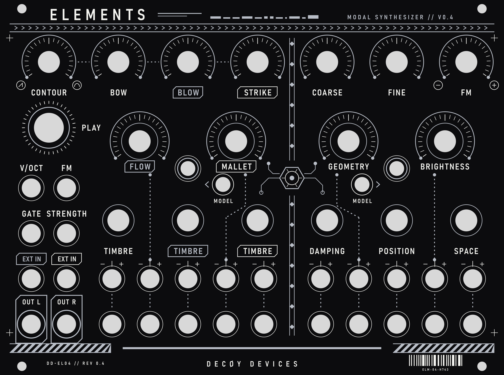
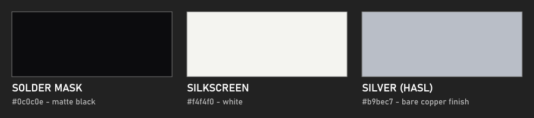
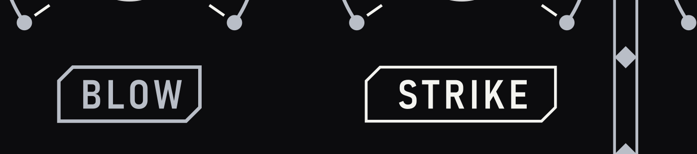
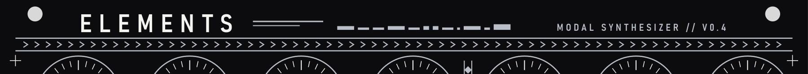
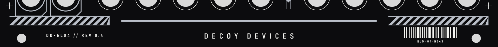
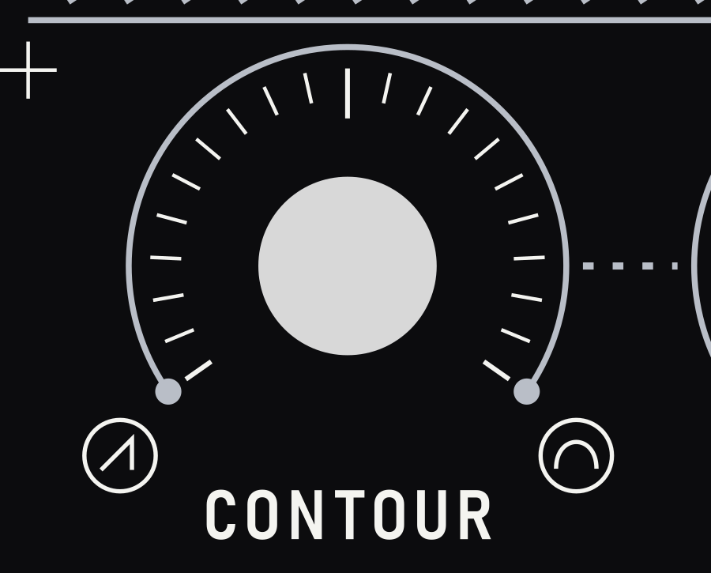
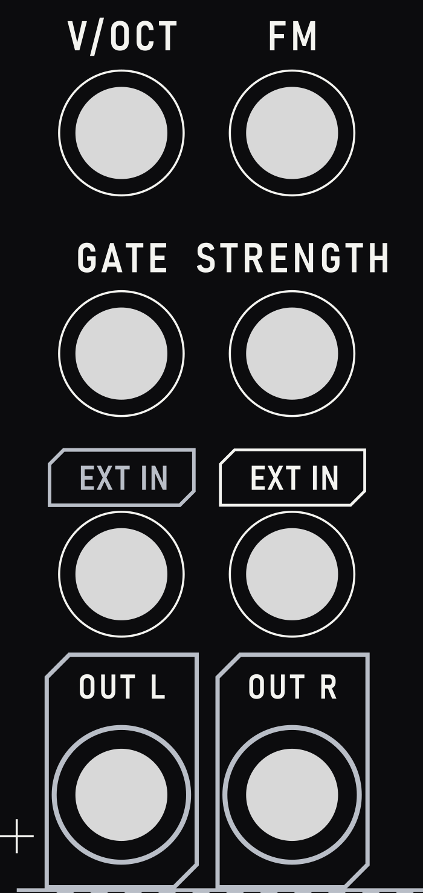
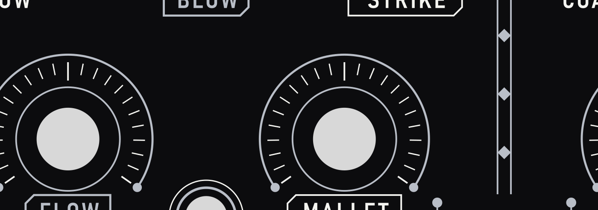
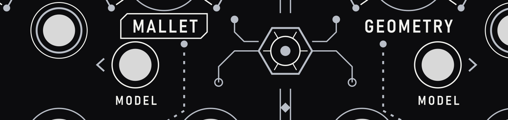
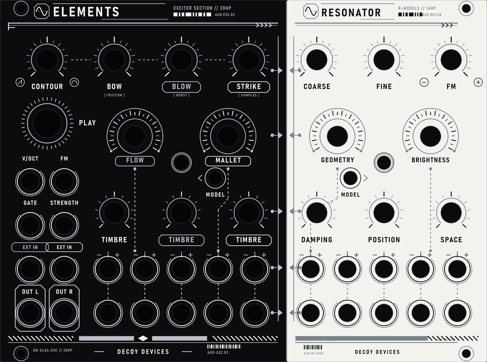

# Grafický manuál – Elements v0.4 front panel (PCB)

**Značka:** DECØY DEVICES  ·  **Produkt:** ELEMENTS – Modal Synthesizer  ·  **Revize:** 0.4 (`DD-EL04`)
**Styl:** cyberpunk / HUD – technické linky, 45° trasování, hazard pruhy, čárový kód, „glitch“ prvky.



---

## 1. Výrobní základ

Panel je desky plošných spojů, takže grafika je omezená na **3 „barvy“ + díry**:

| Vrstva | Barva | Soubor | KiCad vrstva |
| :-- | :-- | :-- | :-- |
| Pájecí maska | matná černá `#0c0c0e` | (podklad) | – |
| Silkscreen | bílá `#f4f4f0` | `F_SilkS.svg` | `F.SilkS` |
| Stříbro (odkrytá měď s povrchem HASL / imerzní cín) | `#b9bec7` | `F_Silver_Cu_Mask.svg` | `F.Cu` **i** `F.Mask` |
| Obrys a díry | – | `Edge_Cuts.svg` | `Edge.Cuts` |



**Pravidla**
- Žádné přechody, stíny ani poloprůhlednost – pouze plná barva.
- Zlato (ENIG) se **nepoužívá**. Stříbrný vzhled dává odkrytá měď s lead-free HASL nebo imerzním cínem (imerzní cín je rovnější; imerzní stříbro časem tmavne).
- Silk čáry min. **0,15 mm**, silk text min. výška **1,0 mm** (nejmenší použitý: 1,1 mm).
- Silk nesmí překrývat odkrytou měď – fab ho tam ořízne. Silk a stříbro jsou proto vždy vedle sebe, nikdy přes sebe.
- Stříbrné plochy jsou izolované (bez sítě); dotyk matic potenciometrů/jacků je neškodný.
- Rozměr: **172,5 × 128,5 mm** (34 HP), počátek v levém horním rohu, jednotky mm.

---

## 2. Dvě barvy → význam

Původní červená/tyrkysová je nahrazena **stylem rámečku**:

| Styl | Vzhled | Význam | Použito u |
| :-- | :-- | :-- | :-- |
| **A** | bílý text, bez rámečku | neutrální | CONTOUR, BOW, COARSE, FINE, FM, GEOMETRY, BRIGHTNESS, DAMPING, POSITION, SPACE, V/OCT, GATE, STRENGTH |
| **B** | stříbrný text + stříbrný seříznutý rámeček | skupina BLOW / FLOW | BLOW, FLOW, TIMBRE, EXT IN (vlevo) |
| **C** | bílý text + bílý seříznutý rámeček | skupina STRIKE / MALLET | STRIKE, MALLET, TIMBRE, EXT IN (vpravo) |



Rámeček: výška **3,9 mm**, seříznutí dvou protilehlých rohů **1,0 mm**, vnitřní okraj textu 3,2 mm (EXT IN 2,4 mm). Čára 0,25 mm (stříbro) / 0,2 mm (silk).

---

## 3. Typografie

- **Písmo:** Bahnschrift, váha SemiBold, šířka SemiCondensed (v souborech **převedeno na křivky**, font je potřeba jen pro přegenerování – součást Windows).
- Pouze **VELKÁ PÍSMENA**, pro technický charakter vždy s rozestupem.

| Použití | Velikost | Rozestup | Barva |
| :-- | :-- | :-- | :-- |
| Název `ELEMENTS` | 5,4 mm | 1,5 mm | bílá |
| Popisky ovladačů a jacků | 2,9 mm (výška verzálek ≈ 2,1 mm; EXT IN 2,4 mm) | 0,28 mm | dle stylu A/B/C |
| Podtitul `MODAL SYNTHESIZER // V0.4` | 2,1 mm | 0,55 mm | stříbrná |
| Značka `DECØY DEVICES` | 2,6 mm | 1,3 mm | bílá |
| `MODEL`, `OUT L/R` | 2,0 / 2,4 mm | 0,3 / 0,25 mm | bílá |
| Servisní řádky (`DD-EL04 // REV 0.4`, `ELM-04-H743`) | 1,5 / 1,1 mm | 0,5 / 0,3 mm | bílá |



---

## 4. Značka a patička

- **DECØY DEVICES** je vždy uprostřed dolního okraje (y = 125,6 mm), s Ø (přeškrtnuté O) jako rozpoznávacím znakem.
- Vlevo servisní kód `DD-EL04 // REV 0.4`, vpravo čárový kód s popisem `ELM-04-H743`.
- Dole po stranách **hazard pruhy** (45°, rozteč 2,4 mm) mezi dvěma tenkými liniemi, uprostřed tenká stříbrná lišta.
- Montážní díry (Ø 3,2 mm) zůstávají vždy volné – žádný text ani linka do vzdálenosti ≈ 3 mm.



---

## 5. Ovladače – piktogramový systém

**Knoby** mají vždy stupnici: bílé rysky (0,15 mm, střední a krajní 0,2 mm) po obloukovém rozsahu ±125° a stříbrný oblouk s body na koncích.

| Typ | Stupnice (poloměr) | Doplněk |
| :-- | :-- | :-- |
| Horní řada (CONTOUR … FM) | rysky 7,0–8,3 mm, 21 ks | stříbrná tečkovaná spojnice mezi skupinou CONTOUR–BOW–BLOW–STRIKE |
| Velké knoby (FLOW, MALLET, GEOMETRY, BRIGHTNESS) | rysky 7,8–9,2 mm, 23 ks | vnitřní stříbrný kruh Ø 12,4 mm |
| Střední řada (TIMBRE, DAMPING, POSITION, SPACE) | – | stříbrný kruh r = 5,4 mm |
| PLAY | 36 rysek r = 8,2–9,2 mm | stříbrný kruh r = 7,0 mm |



- **Polaritní ikony** (CONTOUR: vlevo ostrý náběh – rampa, vpravo oblý náběh – půlvlna; FM: − / +) jsou kroužky Ø 3 mm po stranách pod knobem, mimo koncové body oblouku.
- **Atenuvertery** mají nad sebou mikro-stupnici `− | +`; spodní jacky jsou s nimi spojené stříbrnou tečkovanou linkou.
- **Jacky:** bílý kroužek o 1,15 mm větší než díra. **Výstupy (OUT L/R)** mají místo toho stříbrný kroužek a stříbrný rámeček s oříznutým rohem.
- **Exciter linky** (FLOW, MALLET, GEOMETRY, BRIGHTNESS → atenuvertery) jsou tečkované stříbrné (čárka 0,5 / mezera 0,85 mm, tloušťka 0,3 mm) se zaoblenými koncovými body; obcházejí tlačítka pod 45°.




### Tlačítka výběru modelu a LED
- Dvě tlačítka (Ø 5,1 mm) pod popisky MALLET a GEOMETRY: bílý kroužek r + 1,1 mm, vedle šipka `‹` / `›` ze stříbrné linky 0,28 mm.
- Popisek **`MODEL`** je **vždy pod tlačítkem**, vycentrovaný (2,0 mm).
- Dvě LED (Ø 5,05 mm) nad nimi: stříbrný a bílý dvojitý kroužek, bez popisku.



---

## 6. Dekorativní prvky (cyberpunk)

| Prvek | Popis |
| :-- | :-- |
| Hlavička | dvě stříbrné linky + řada šipek `>>>`, vedle názvu „glitch“ linky a pruh datových bloků |
| Střední předěl | dvojitá stříbrná linka, kosočtverce po 7 mm, přerušená u emblému |
| Emblém | šestiúhelník s kruhem a rysky 60°, ze kterého vedou 45° stopy zakončené body/vias |
| Registrační kříže | 4× bílý kříž 2,4 mm v rozích grafické plochy |
| Hazard pruhy | stříbrné šikmé pruhy v dolních rozích |
| Čárový kód | bílý, generovaný (seed 404), vpravo dole |


---

## 7. Mřížka a rozmístění

- Sloupce knobů: ≈ 23,8 mm rozteč (horní a střední řada); sloupce atenuverterů ≈ 13 mm.
- Popisky ovladačů leží **vždy pod ovladačem**: horní řada y ≈ 31,7 mm, velké knoby y ≈ 57 mm, střední řada y ≈ 86 mm.
- Prostor kolem děr: pot Ø 7,5 mm, jack Ø 6,5 mm, PLAY Ø 10,2 mm, LED/tlačítko Ø ≈ 5,1 mm, montáž Ø 3,2 mm.
- Souřadnice všech děr se načítají přímo z `../ElementsV04.svg` – při změně otvorů stačí soubor aktualizovat a spustit build.

---

## 8. Soubory a postup

```
pcb_art/
  gen_panel.py            generátor (celá grafika je kód)
  build.ps1               sestavení + převod textu na křivky + náhled
  F_SilkS.svg             bílý silk
  F_Silver_Cu_Mask.svg    stříbro (F.Cu + F.Mask)
  Edge_Cuts.svg           obrys a díry
  preview.svg / .png      kompozit (maska + silk + stříbro)
  GRAPHIC_MANUAL.md       tento dokument
  manual_img/             ilustrace pro manuál
```

**Sestavení:** `powershell -ExecutionPolicy Bypass -File build.ps1` (vyžaduje Python 3 a Inkscape).

**Import do KiCadu:** File → Import → Graphics, měřítko 1:1, mm – každý SVG na uvedenou vrstvu. Stříbro importujte na `F.Cu` i `F.Mask` (maska otevřená přesně nad mědí). Poté spusťte DRC.

**Objednávka u výrobce:** černá maska, bílý silk, povrch lead-free HASL nebo imerzní cín, deska 1,6 mm, 2 vrstvy stačí.

---

## 9. Dvoudílné provedení (Split Panel: 20 HP Černá + 14 HP Bílá)

Protože výrobci DPS (JLCPCB, PCBWay apod.) neumožňují kombinovat dvě barvy nepájivé masky na jedné desce, je pro dosažení **černo-bílého kontrastu** panel rozdělen na **dva samostatné fyzické plošné spoje**, které v racku sedí těsně vedle sebe:



### Srovnání obou částí

| Parametr | EXCITER (levá část) | RESONATOR (pravá část) |
| :-- | :-- | :-- |
| **Šířka / HP** | **20 HP** (101,4 × 128,5 mm) | **14 HP** (70,9 × 128,5 mm) |
| **Pájecí maska** | Matná černá (`#0c0c0e`) | Čistě bílá (`#ffffff`) |
| **Silkscreen (potisk)** | Bílý (`#f4f4f0`) | Hluboce černý (`#111113`) |
| **Odkrytá měď (stříbro)** | Lead-free HASL / imerzní cín (`#b9bec7`) | Lead-free HASL / imerzní cín (`#b9bec7`) |
| **Ovladače & konektory** | 30 funkčních otvorů (4 poty nahoře, 2 velké poty, 3 poty timbre, 18 jacků, PLAY, LED, MODEL 1) | 20 funkčních otvorů (3 poty nahoře, 2 velké poty, 3 poty damping/pos/space, 10 jacků, LED, MODEL 2) |
| **Montážní otvory (Eurorack)** | **2 vnější otvory** Ø 3,2 mm (pouze vlevo: x = 7,49 mm; y = 2,99 a 125,51 mm) | **2 vnější otvory** Ø 3,2 mm (pouze vpravo: x = 63,57 mm; y = 2,99 a 125,51 mm) |
| **Celkem otvorů na panelu** | **32 otvorů** | **22 otvorů** (celkem 54 otvorů odpovídajících `ElementsV04.svg`) |
| **Složka souborů** | `pcb_art/split/exciter/` | `pcb_art/split/resonator/` |

### Nová funkčnost tlačítek MODEL

Na v0.4 panelu jsou dvě nezávislá tlačítka s LED indikátory a čistým popiskem `MODEL` přímo pod tlačítkem:

1. **Tlačítko 1 – EXCITER MODEL (levý panel, x = 76,31 mm, y = 63,21 mm):**
   - Přepíná mezi **2 modely budičů**:
     - **1: CLASSIC** – Původní modely budičů Elements (syntéza smyčce, foukání a paličky).
     - **2: INDUSTRIAL** – Industriální sada hrubých zvuků:
       - **BOW:** Tření kov o kov (`[ FRICTION ]`)
       - **BLOW:** Digitální burst šum (`[ BURST ]`)
       - **STRIKE:** Industriální perkusivní sada samplů (`[ SAMPLES ]`)
   - Směr k LED diodě ukazuje stříbrná šipka `<`.

2. **Tlačítko 2 – RESONATOR MODEL (pravý panel, x = 22,50 mm, y = 63,21 mm):**
   - Přepíná mezi **8 modely rezonátorů**:
     - **1: MODAL** – Původní Elements banka 64 laděných pásmových filtrů.
     - **2: STRING** – Původní Elements nelineární model struny.
     - **3: STRINGS** – Původní Elements 5hlasý akordický shluk strun.
     - **4: QUANT** – Port z Rings: laděné sympatetické struny kvantované na půltóny.
     - **5: REVERB** – Port z Rings: strunový model integrovaný s reverbem.
     - **6: FM VOX** – Port z Rings: 2-operátorový FM syntezátor.
     - **7: SYNTH** – Port z Rings: smyčcový ensemble (Solina/string machine).
     - **8: CLOUDS\*** – Implementace Kammerl Spectral Clouds (v patičce servisní označení `KAMMERL DSP // *CLOUDS`).
   - Směr k LED diodě ukazuje stříbrná šipka `>`. Popisky modelů jsou v dokumentaci a manuálu, panel zůstává vizuálně čistý bez rozměrných tabulek.

### Pravidla a detaily dvoudílného návrhu

1. **Montáž bez vnitřních děr do racku:**
   - Panel je fyzicky rozdělen na 2 díly (20 HP + 14 HP = 34 HP), avšak **hlavní motherboard PCB pod ním je celistvá**.
   - Oba panely jsou k motherboardu pevně staženy maticemi všech 17 potenciometrů a 28 jackových konektorů.
   - Vnitřní díry do racku u dělícího švu (x = 101,4 mm) byly **zcela odstraněny**, aby nerušily estetiku panelu a nebránily umístění ovladačů. Do rackové lišty se šroubují pouze 4 vnější rohy modulu.
2. **Kyberpunková sběrnice na spoji:**
   - V místě styku obou panelů (x = 101,4 mm) jsou stříbrné zakončovací linky a interface uzly (`py_node = 25, 48, 75, 95, 111 mm`).
   - Levé šipky `->` opticky „vstupují“ do pravého panelu jako datový tok z budiče (Exciter) do rezonátoru (Resonator).
3. **Objednávka u výrobce:**
   - **Zakázka 1 (Exciter):** Solder mask: `Matte Black`, Silkscreen: `White`, Surface Finish: `Lead-free HASL` (nebo `Immersion Tin`), 1.6 mm.
   - **Zakázka 2 (Resonator):** Solder mask: `White`, Silkscreen: `Black`, Surface Finish: `Lead-free HASL` (nebo `Immersion Tin`), 1.6 mm.

---

## 10. Struktura souborů

```
pcb_art/
  ├── gen_panel.py              # Generátor celistvého 34HP panelu
  ├── build.ps1                 # Build celistvého 34HP panelu
  ├── gen_split_panels.py        # Generátor dvoudílného panelu (20HP + 14HP)
  ├── build_split.ps1           # Build dvoudílného panelu + převod textů na křivky
  ├── GRAPHIC_MANUAL.md         # Tento grafický manuál
  │
  ├── split/                    # DVOUDÍLNÁ VARIANTA (ČERNÁ + BÍLÁ)
  │   ├── split_panels_preview.png  # Náhled obou panelů v racku
  │   ├── exciter/              # 20 HP Exciter (černá maska / bílý silk)
  │   │   ├── Exciter_Edge_Cuts.svg
  │   │   ├── Exciter_F_SilkS.svg
  │   │   ├── Exciter_F_Silver_Cu_Mask.svg
  │   │   └── Exciter_preview.png
  │   └── resonator/            # 14 HP Resonator (bílá maska / černý silk)
  │       ├── Resonator_Edge_Cuts.svg
  │       ├── Resonator_F_SilkS.svg
  │       ├── Resonator_F_Silver_Cu_Mask.svg
  │       └── Resonator_preview.png
  │
  ├── F_SilkS.svg               # Celistvý 34HP bílý silk
  ├── F_Silver_Cu_Mask.svg      # Celistvé 34HP stříbro
  ├── Edge_Cuts.svg             # Celistvý 34HP obrys
  └── preview.png               # Celistvý 34HP náhled
```

---

## 11. Dělat / nedělat

- ✅ Zachovat styly A/B/C a popisek `MODEL` pod tlačítkem.
- ✅ Pro černou masku použít bílý silk, pro bílou masku použít černý silk.
- ✅ Odkrytá měď (stříbrná) zůstává na obou panelech sjednocujícím kovovým prvkem.
- ❌ Nepřidávat další barvy ani přechody.
- ❌ Nedávat potisk přes stříbrné plošky mědi.


